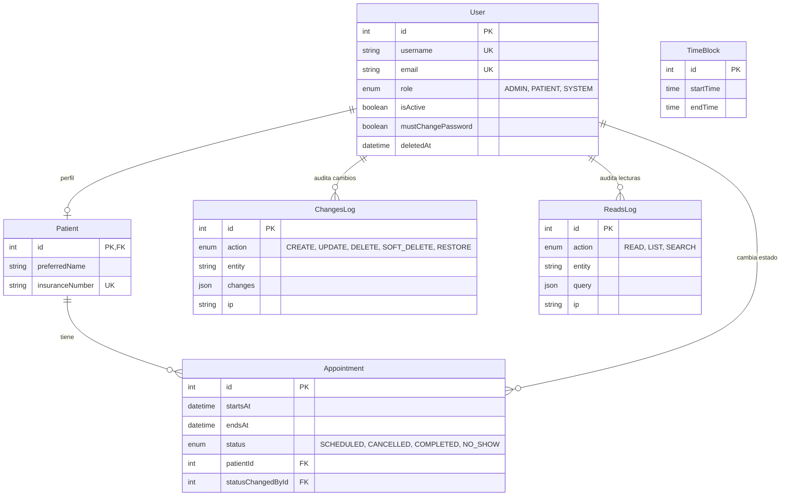

# API Clínica

API REST para la gestión de citas médicas: registro de pacientes, bloques horarios, agendamiento de citas, control de acceso por roles y auditoría completa de lecturas y cambios.

**Demo en vivo:** https://api-clinica-2n4z.onrender.com

> La demo corre en el plan gratuito de Render: tras 15 minutos sin tráfico el servicio se apaga y la primera petición puede tardar hasta un minuto en responder. Haz una petición a `/` para despertarlo.

## Tecnologías

| Área | Herramienta |
| --- | --- |
| Runtime / framework | Node.js (>= 20), Express 5 |
| Base de datos | PostgreSQL gestionado con Prisma Postgres (administrado desde Prisma Console) |
| ORM y migraciones | Prisma 6 con el adaptador `@prisma/adapter-pg` (driver `pg`) |
| Autenticación | JSON Web Tokens (`jsonwebtoken`), contraseñas con `bcryptjs` |
| Protección | `express-rate-limit` |
| CI/CD | GitHub Actions |
| Hosting de la API | Render |

## Funcionalidades

- **Roles y permisos**: `ADMIN`, `PATIENT` y `SYSTEM`, con autorización por ruta.
- **Registro público de pacientes** y creación de pacientes y administradores por parte de un admin.
- **Cambio obligatorio de contraseña** para cuentas creadas por un administrador (`mustChangePassword`).
- **Bloques horarios**: creación manual o generación masiva, y consulta de los disponibles.
- **Citas**: agendar, consultar, cancelar y completar. Estados `SCHEDULED`, `CANCELLED`, `COMPLETED` y `NO_SHOW`.
- **Cierre automático del día**: un job se ejecuta a las 00:05 (hora de la clínica) y marca como `NO_SHOW` las citas vencidas. Al arrancar el servidor también se ejecuta una vez, para recuperar el cierre si estuvo apagado a esa hora.
- **Integridad en la base de datos**: restricciones de exclusión y de rango impiden citas o bloques solapados; los errores de Prisma y de Postgres se traducen a respuestas HTTP claras (409, 404, 400).
- **Auditoría**:
  - *Cambios*: triggers en PostgreSQL registran cada creación, actualización y borrado en `ChangesLog`, con el usuario que actuó y su IP.
  - *Lecturas*: un middleware registra consultas exitosas (lectura, listado y búsqueda) en `ReadsLog`.
- **Borrado lógico** de usuarios (`deletedAt`).
- **Paginación por cursor** en los listados.
- **Rate limiting** por IP, por cuenta y por usuario en registro, login, cambio de contraseña, listados y creación de pacientes.

## Seguridad

### Autenticación y sesiones

- **Contraseñas con hash**: bcrypt (`bcryptjs`) con coste 10. Nunca se guardan en texto plano.
- **Login sin enumeración de usuarios**: una cuenta inexistente y una contraseña incorrecta devuelven el mismo error (401 `INVALID_CREDENTIALS`). Si la cuenta no existe, se compara contra un hash falso, para que ambos caminos hagan el mismo trabajo costoso y no se distingan por el tiempo de respuesta.
- **Estado de la cuenta**: una cuenta deshabilitada (403) solo se revela a quien ya presentó la contraseña correcta.
- **Registro sin enumeración**: el endpoint responde de inmediato con `202 Accepted` y el mismo mensaje, y procesa el registro en segundo plano. Por eso ni la respuesta ni su tiempo dependen de si el correo o el número de seguro ya existían; en ese caso se avisa al titular por correo (simulado).
- **Tokens JWT** firmados con `JWT_SECRET` y con expiración de 1 hora. En cada petición protegida se consulta la base: el usuario debe existir, estar activo y no estar eliminado, así que desactivar una cuenta corta su acceso de inmediato.
- **Invalidación al cambiar la contraseña**: los tokens emitidos antes del último cambio dejan de valer (se compara la fecha de emisión del token con `passwordChangedAt`), y el cambio devuelve un token nuevo.
- **Cambio obligatorio de contraseña**: las cuentas creadas por un administrador tienen `mustChangePassword`. Mientras esté activo, todas las rutas protegidas responden 403 `MUST_CHANGE_PASSWORD`, y solo queda disponible el cambio de contraseña.

### Protección contra abuso

Limitación de peticiones con `express-rate-limit`. Las respuestas 429 pasan por el manejador de errores central y usan el mismo formato que el resto.

| Limitador | Clave | Límite |
| --- | --- | --- |
| Registro por IP | IP | 5 por hora |
| Registro por correo | Correo | 3 por hora |
| Login por IP | IP | 20 fallos cada 15 min |
| Login por cuenta | Cuenta | 10 fallos por hora |
| Cambio de contraseña | Usuario | 5 fallos cada 5 min |
| Token ausente o inválido | IP | 30 errores cada 15 min |
| Tope general | Usuario | 450 cada 15 min |
| Listados (contador compartido) | Usuario | 60 cada 15 min |
| Creación de pacientes | Usuario | 40 por hora |

- En el login por cuenta, los identificadores que no existen también tienen su contador, para que el bloqueo no delate qué cuentas existen.
- En el login solo cuentan los intentos fallidos.
- Al primer bloqueo de una cuenta se avisa a su dueño (correo simulado).

### Control de acceso y validación

- **Autorización por rol** en cada ruta (`authorize`).
- **Lista blanca de campos** editables por rol en las actualizaciones de perfil (`allowFields`): un campo no permitido responde 403 y se indica cuál.
- **Validación de entradas** (`body`, `query` y `params`) antes de los controladores, que solo usan los datos ya validados.

### Errores, registros y secretos

- **Errores controlados**: los errores de servidor (5xx) devuelven un mensaje genérico y nunca los detalles internos; la traza solo se incluye en modo `development`. Los errores de la base de datos se traducen a respuestas HTTP definidas.
- **Registro de peticiones** sin cuerpos ni cabeceras, así que ni contraseñas ni tokens llegan a los logs.
- **Auditoría** de cambios (triggers en la base) y de lecturas, con el usuario y la IP de cada acción.
- **IP real del cliente** detrás del proxy de Render (`trust proxy`), para que la limitación de peticiones y la auditoría usen la dirección correcta.
- **Secretos fuera del repositorio**: variables de entorno en Render y secrets de GitHub en un environment restringido. Las credenciales del administrador inicial nunca se versionan.

### Limitaciones conocidas

- Los contadores del rate limiting viven en memoria: se reinician con cada reinicio del servicio y no se comparten entre instancias. Con varias instancias haría falta un almacén común como Redis.
- Los correos son simulados (se imprimen en consola).
- No hay recuperación de contraseña, refresh tokens ni autenticación de dos factores. Un token solo se invalida cambiando la contraseña o desactivando la cuenta.
- El registro es asíncrono: si falla por un motivo inesperado, el usuario ya recibió el 202 y el error solo queda en los logs.

## Modelo de datos



## Endpoints

Todas las rutas cuelgan de `/api`. Excepto `/auth/register` y `/auth/login`, requieren un token en la cabecera `Authorization: Bearer <token>`.

### Autenticación — `/api/auth`

| Método | Ruta | Acceso | Descripción |
| --- | --- | --- | --- |
| POST | `/register` | Público | Registro de paciente |
| POST | `/login` | Público | Inicio de sesión, devuelve el token |
| POST | `/change-password` | Autenticado | Cambio de contraseña |

### Usuarios — `/api/users`

| Método | Ruta | Acceso | Descripción |
| --- | --- | --- | --- |
| GET | `/me` | Autenticado | Mi perfil |
| PATCH | `/me` | Autenticado | Actualizar mi perfil |
| GET | `/` | Admin | Listar usuarios |
| GET | `/:id` | Admin | Ver un usuario |
| PATCH | `/:id` | Admin | Actualizar un usuario |

### Administradores — `/api/admins`

| Método | Ruta | Acceso | Descripción |
| --- | --- | --- | --- |
| POST | `/` | Admin | Crear administrador |
| DELETE | `/:id` | Admin | Eliminar administrador |

### Pacientes — `/api/patients`

| Método | Ruta | Acceso | Descripción |
| --- | --- | --- | --- |
| GET | `/me` | Paciente | Mi perfil de paciente |
| PATCH | `/me` | Paciente | Actualizar mi perfil de paciente |
| POST | `/` | Admin | Crear paciente |
| GET | `/` | Admin | Listar pacientes |
| GET | `/:id` | Admin | Ver un paciente |
| PATCH | `/:id` | Admin | Actualizar un paciente |
| DELETE | `/:id` | Admin | Eliminar un paciente |

### Bloques horarios — `/api/timeBlocks`

| Método | Ruta | Acceso | Descripción |
| --- | --- | --- | --- |
| GET | `/available` | Autenticado | Bloques disponibles |
| GET | `/` | Autenticado | Listar bloques |
| GET | `/:id` | Autenticado | Ver un bloque |
| POST | `/` | Admin | Crear bloque |
| POST | `/generate` | Admin | Generar bloques en lote |
| PATCH | `/:id` | Admin | Actualizar bloque |
| DELETE | `/:id` | Admin | Eliminar bloque |

### Citas — `/api/appointments`

| Método | Ruta | Acceso | Descripción |
| --- | --- | --- | --- |
| POST | `/` | Paciente, Admin | Agendar una cita |
| GET | `/` | Paciente, Admin | Listar citas |
| GET | `/:id` | Paciente, Admin | Ver una cita |
| POST | `/:id/cancel` | Paciente, Admin | Cancelar una cita |
| POST | `/:id/complete` | Admin | Marcar una cita como completada |

### Auditoría — `/api/audit`

| Método | Ruta | Acceso | Descripción |
| --- | --- | --- | --- |
| GET | `/reads-logs` | Admin | Registro de lecturas |
| GET | `/changes-logs` | Admin | Registro de cambios |

## Probar la API

### Con Postman

[](https://god.gw.postman.com/run-collection/58038959-d6e84c4c-8492-4149-be0b-b260a33a685f?action=collection%2Ffork&source=rip_markdown&collection-url=entityId%3D58038959-d6e84c4c-8492-4149-be0b-b260a33a685f%26entityType%3Dcollection%26workspaceId%3Dca158b41-0e4e-4025-ac64-255bd4b51c08#?env%5BProd%5D=W3sia2V5IjoiYmFzZV91cmwiLCJ2YWx1ZSI6Imh0dHBzOi8vYXBpLWNsaW5pY2EtMm40ei5vbnJlbmRlci5jb20vYXBpIiwiZW5hYmxlZCI6dHJ1ZSwidHlwZSI6ImRlZmF1bHQifSx7ImtleSI6InRva2VuIiwiZW5hYmxlZCI6dHJ1ZSwidHlwZSI6ImRlZmF1bHQiLCJzZWNyZXQiOnRydWUsInZhbHVlIjoiIn1d)

La colección incluye todos los endpoints organizados por carpetas, con el environment **Prod** ya apuntando a la demo.

1. Pulsa el botón y elige *Fork Collection* (necesitas una cuenta gratuita de Postman).
2. Selecciona el environment **Prod** en la esquina superior derecha.
3. Inicia sesión con la petición de login; el resto de las peticiones usan el token obtenido.

Más recursos:

- [Workspace público en Postman](https://www.postman.com/alexander404-hz-6871307/api-clinica/collection/puhk2ks/clinica-api)
- [Documentación publicada](https://documenter.getpostman.com/view/58038959/2sBYHVwK8e)
- **Importación manual**: la colección y los environments están exportados en [`docs/postman/`](docs/postman/). Impórtalos desde Postman con *Import*.

> La primera petición puede tardar hasta un minuto si el servicio estaba dormido (plan gratuito de Render).

<!-- TODO: añadir aquí la cuenta de demo (usar una cuenta de paciente, no la de administrador) -->
<!-- TODO: cuando exista, añadir aquí el enlace a Swagger (/api-docs) -->

## Ejecutar en local

Requisitos: Node.js 20 o superior y PostgreSQL 17 o superior (probado con la 17.2 en producción y la 18.6 en local).

```bash
git clone https://github.com/alexander404-hz/API-Clinica.git
cd API-Clinica
npm install
cp .env-example .env     # y edita los valores
npm run db:migrate       # aplica las migraciones
npm run seed             # datos de referencia
npm run db:bootstrap     # usuarios iniciales del sistema
npm run dev
```

### Variables de entorno

| Variable | Descripción |
| --- | --- |
| `NODE_ENV` | `development` en local, `production` en el despliegue |
| `PORT` | Puerto del servidor (por defecto `3005`) |
| `DOMAIN` | Dominio mostrado en el log de arranque |
| `DATABASE_URL` | Cadena de conexión que usa la API en tiempo de ejecución. En producción, la URL *pooled* (`pooled.db.prisma.io`) |
| `DIRECT_DATABASE_URL` | Conexión directa (`db.prisma.io`), usada por Prisma solo para las migraciones. En local, el mismo valor que `DATABASE_URL` |
| `JWT_SECRET` | Secreto para firmar los tokens |
| `SEED_ADMIN_USERNAME`, `SEED_ADMIN_EMAIL`, `SEED_ADMIN_PASSWORD`, `SEED_ADMIN_FIRST_NAME`, `SEED_ADMIN_LAST_NAME` | Solo producción: datos del administrador inicial. En local se usan valores por defecto |

Para generar un secreto:

```bash
node -e "console.log(require('crypto').randomBytes(64).toString('hex'))"
```

### Scripts

| Script | Acción |
| --- | --- |
| `npm run dev` | Servidor con recarga automática |
| `npm start` | Servidor en modo producción |
| `npm run db:migrate` | Crea y aplica migraciones (desarrollo) |
| `npm run db:deploy` | Aplica migraciones existentes (producción) |
| `npm run db:reset` | Reinicia la base de datos (solo desarrollo) |
| `npm run seed` | Carga datos de referencia |
| `npm run db:bootstrap` | Crea los usuarios iniciales |

## Despliegue

La API se despliega en **Render**, la base de datos vive en **Prisma Postgres** y el proceso se automatiza con **GitHub Actions**. Render no ofrece SSH en el plan gratuito, así que las migraciones y la carga inicial de datos se ejecutan desde los workflows.

```text
push a master
     │
     ▼
GitHub Actions: Deploy
     ├─ npm ci
     ├─ prisma migrate deploy   (aplica las migraciones pendientes)
     └─ deploy hook de Render   (solo si la migración fue exitosa)
```

| Workflow | Disparador | Qué hace |
| --- | --- | --- |
| `Deploy` (`.github/workflows/deploy.yml`) | Push a `master` o ejecución manual | Aplica las migraciones y dispara el despliegue en Render |
| `Initialize data` (`.github/workflows/init-data.yml`) | Solo manual | Ejecuta `prisma/seed.js` y `prisma/bootstrap.js` para cargar datos de referencia y crear el administrador inicial |

Decisiones de diseño:

- **Migrar antes de desplegar**, para que el código nuevo nunca corra contra un esquema viejo.
- **Un grupo de `concurrency` compartido**, para que una migración y la carga inicial no se ejecuten a la vez.
- **Dos conexiones a la base**: la API usa la URL con *pooling* para soportar mejor los reinicios y arranques en frío de Render, y las migraciones usan la conexión directa (`directUrl` en `schema.prisma`).
- **Prisma con el adaptador `pg`**: durante las pruebas, el motor por defecto de Prisma 6 dio timeouts del pool de conexiones tras unos minutos de inactividad contra Prisma Postgres, mientras que el driver `pg` respondía con normalidad. Con el adaptador `@prisma/adapter-pg` esos timeouts no se reprodujeron.
- **Secrets en un environment `production`** de GitHub, restringido a la rama principal.
- **Carga inicial separada del despliegue**: se ejecuta una sola vez y de forma manual, así los datos iniciales no se vuelven a tocar en cada push.

## Estructura del proyecto

```text
.
├── .github/workflows/   # Deploy e Initialize data
├── docs/postman/        # Colección y environments de Postman
├── prisma/              # schema, migraciones, seed y bootstrap
└── src/
    ├── constants/       # Constantes y códigos de error
    ├── controllers/     # Capa HTTP
    ├── services/        # Lógica de negocio
    ├── validators/      # Validación de entradas
    ├── middlewares/     # Auth, autorización, rate limiting, errores
    ├── routes/          # Definición de rutas
    ├── jobs/            # Cierre automático del día
    ├── helpers/         # Utilidades de dominio
    └── utils/           # Auditoría, paginación, errores
```

## Autor

**Alexander Hz** — [@alexander404-hz](https://github.com/alexander404-hz)

Licencia ISC.