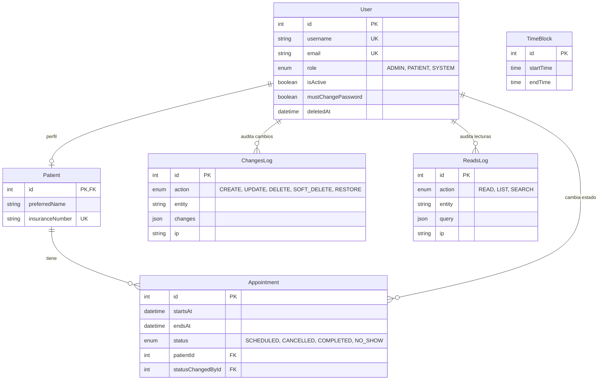

# API Clínica

API REST para la gestión de citas médicas: registro de pacientes, bloques horarios, agendamiento de citas, control de acceso por roles y auditoría completa de lecturas y cambios.

**Demo en vivo:** https://api-clinica-2n4z.onrender.com

> La demo corre en el plan gratuito de Render: tras 15 minutos sin tráfico el servicio se apaga y la primera petición puede tardar hasta un minuto en responder. Haz una petición a `/` para despertarlo.

## Tecnologías

| Área | Herramienta |
| --- | --- |
| Runtime / framework | Node.js (>= 20), Express 5 |
| Base de datos | PostgreSQL alojado en Prisma Postgres |
| ORM y migraciones | Prisma 6 |
| Autenticación | JSON Web Tokens (`jsonwebtoken`), contraseñas con `bcryptjs` |
| Protección | `express-rate-limit` |
| CI/CD | GitHub Actions |
| Hosting de la API | Render |

## Funcionalidades

- **Roles y permisos**: `ADMIN`, `PATIENT` y `SYSTEM`, con autorización por ruta.
- **Registro público de pacientes** y creación de pacientes y administradores por parte de un admin.
- **Cambio obligatorio de contraseña** para cuentas creadas por un administrador (`mustChangePassword`).
- **Bloques horarios**: creación manual o generación masiva, y consulta de los disponibles.
- **Citas**: agendar, consultar, cancelar y completar. Estados `SCHEDULED`, `CANCELLED`, `COMPLETED` y `NO_SHOW`.
- **Cierre automático del día**: un job se ejecuta a las 00:05 (hora de la clínica) y marca como `NO_SHOW` las citas vencidas. Al arrancar el servidor también se ejecuta una vez, para recuperar el cierre si estuvo apagado a esa hora.
- **Integridad en la base de datos**: restricciones de exclusión y de rango impiden citas o bloques solapados; los errores de Prisma y de Postgres se traducen a respuestas HTTP claras (409, 404, 400).
- **Auditoría**:
  - *Cambios*: triggers en PostgreSQL registran cada creación, actualización y borrado en `ChangesLog`, con el usuario que actuó y su IP.
  - *Lecturas*: un middleware registra consultas exitosas (lectura, listado y búsqueda) en `ReadsLog`.
- **Borrado lógico** de usuarios (`deletedAt`).
- **Paginación por cursor** en los listados.
- **Rate limiting** por IP, por cuenta y por usuario en registro, login, cambio de contraseña, listados y creación de pacientes.

## Modelo de datos



## Endpoints

Todas las rutas cuelgan de `/api`. Excepto `/auth/register` y `/auth/login`, requieren un token en la cabecera `Authorization: Bearer <token>`.

### Autenticación — `/api/auth`

| Método | Ruta | Acceso | Descripción |
| --- | --- | --- | --- |
| POST | `/register` | Público | Registro de paciente |
| POST | `/login` | Público | Inicio de sesión, devuelve el token |
| POST | `/change-password` | Autenticado | Cambio de contraseña |

### Usuarios — `/api/users`

| Método | Ruta | Acceso | Descripción |
| --- | --- | --- | --- |
| GET | `/me` | Autenticado | Mi perfil |
| PATCH | `/me` | Autenticado | Actualizar mi perfil |
| GET | `/` | Admin | Listar usuarios |
| GET | `/:id` | Admin | Ver un usuario |
| PATCH | `/:id` | Admin | Actualizar un usuario |

### Administradores — `/api/admins`

| Método | Ruta | Acceso | Descripción |
| --- | --- | --- | --- |
| POST | `/` | Admin | Crear administrador |
| DELETE | `/:id` | Admin | Eliminar administrador |

### Pacientes — `/api/patients`

| Método | Ruta | Acceso | Descripción |
| --- | --- | --- | --- |
| GET | `/me` | Paciente | Mi perfil de paciente |
| PATCH | `/me` | Paciente | Actualizar mi perfil de paciente |
| POST | `/` | Admin | Crear paciente |
| GET | `/` | Admin | Listar pacientes |
| GET | `/:id` | Admin | Ver un paciente |
| PATCH | `/:id` | Admin | Actualizar un paciente |
| DELETE | `/:id` | Admin | Eliminar un paciente |

### Bloques horarios — `/api/timeBlocks`

| Método | Ruta | Acceso | Descripción |
| --- | --- | --- | --- |
| GET | `/available` | Autenticado | Bloques disponibles |
| GET | `/` | Autenticado | Listar bloques |
| GET | `/:id` | Autenticado | Ver un bloque |
| POST | `/` | Admin | Crear bloque |
| POST | `/generate` | Admin | Generar bloques en lote |
| PATCH | `/:id` | Admin | Actualizar bloque |
| DELETE | `/:id` | Admin | Eliminar bloque |

### Citas — `/api/appointments`

| Método | Ruta | Acceso | Descripción |
| --- | --- | --- | --- |
| POST | `/` | Paciente, Admin | Agendar una cita |
| GET | `/` | Paciente, Admin | Listar citas |
| GET | `/:id` | Paciente, Admin | Ver una cita |
| POST | `/:id/cancel` | Paciente, Admin | Cancelar una cita |
| POST | `/:id/complete` | Admin | Marcar una cita como completada |

### Auditoría — `/api/audit`

| Método | Ruta | Acceso | Descripción |
| --- | --- | --- | --- |
| GET | `/reads-logs` | Admin | Registro de lecturas |
| GET | `/changes-logs` | Admin | Registro de cambios |

<!-- TODO: cuando exista, añadir aquí el enlace a Swagger (/api-docs) y a la colección de Postman -->

## Ejecutar en local

Requisitos: Node.js 20 o superior y una base PostgreSQL.

```bash
git clone https://github.com/alexander404-hz/API-Clinica.git
cd API-Clinica
npm install
cp .env-example .env     # y edita los valores
npm run db:migrate       # aplica las migraciones
npm run seed             # datos de referencia
npm run db:bootstrap     # usuarios iniciales del sistema
npm run dev
```

### Variables de entorno

| Variable | Descripción |
| --- | --- |
| `NODE_ENV` | `development` en local, `production` en el despliegue |
| `PORT` | Puerto del servidor (por defecto `3005`) |
| `DOMAIN` | Dominio mostrado en el log de arranque |
| `DATABASE_URL` | Cadena de conexión de PostgreSQL |
| `JWT_SECRET` | Secreto para firmar los tokens |
| `SEED_ADMIN_USERNAME`, `SEED_ADMIN_EMAIL`, `SEED_ADMIN_PASSWORD`, `SEED_ADMIN_FIRST_NAME`, `SEED_ADMIN_LAST_NAME` | Solo producción: datos del administrador inicial. En local se usan valores por defecto |

Para generar un secreto:

```bash
node -e "console.log(require('crypto').randomBytes(64).toString('hex'))"
```

### Scripts

| Script | Acción |
| --- | --- |
| `npm run dev` | Servidor con recarga automática |
| `npm start` | Servidor en modo producción |
| `npm run db:migrate` | Crea y aplica migraciones (desarrollo) |
| `npm run db:deploy` | Aplica migraciones existentes (producción) |
| `npm run db:reset` | Reinicia la base de datos (solo desarrollo) |
| `npm run seed` | Carga datos de referencia |
| `npm run db:bootstrap` | Crea los usuarios iniciales |

## Despliegue

La API se despliega en **Render**, la base de datos vive en **Prisma Postgres** y el proceso se automatiza con **GitHub Actions**. Render no ofrece SSH en el plan gratuito, así que las migraciones y la carga inicial de datos se ejecutan desde los workflows.

```text
push a master
     │
     ▼
GitHub Actions: Deploy
     ├─ npm ci
     ├─ prisma migrate deploy   (aplica las migraciones pendientes)
     └─ deploy hook de Render   (solo si la migración fue exitosa)
```

| Workflow | Disparador | Qué hace |
| --- | --- | --- |
| `Deploy` (`.github/workflows/deploy.yml`) | Push a `master` o ejecución manual | Aplica las migraciones y dispara el despliegue en Render |
| `Initialize data` (`.github/workflows/init-data.yml`) | Solo manual | Ejecuta `prisma/seed.js` y `prisma/bootstrap.js` para cargar datos de referencia y crear el administrador inicial |

Decisiones de diseño:

- **Migrar antes de desplegar**, para que el código nuevo nunca corra contra un esquema viejo.
- **Un grupo de `concurrency` compartido**, para que una migración y la carga inicial no se ejecuten a la vez.
- **Secrets en un environment `production`** de GitHub, restringido a la rama principal.
- **Carga inicial separada del despliegue**: se ejecuta una sola vez y de forma manual, así los datos iniciales no se vuelven a tocar en cada push.

## Estructura del proyecto

```text
.
├── .github/workflows/   # Deploy e Initialize data
├── prisma/              # schema, migraciones, seed y bootstrap
└── src/
    ├── constants/       # Constantes y códigos de error
    ├── controllers/     # Capa HTTP
    ├── services/        # Lógica de negocio
    ├── validators/      # Validación de entradas
    ├── middlewares/     # Auth, autorización, rate limiting, errores
    ├── routes/          # Definición de rutas
    ├── jobs/            # Cierre automático del día
    ├── helpers/         # Utilidades de dominio
    └── utils/           # Auditoría, paginación, errores
```

## Autor

**Alexander Hz** — [@alexander404-hz](https://github.com/alexander404-hz)

Licencia ISC.